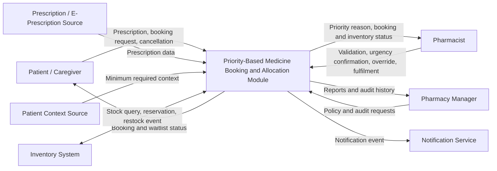
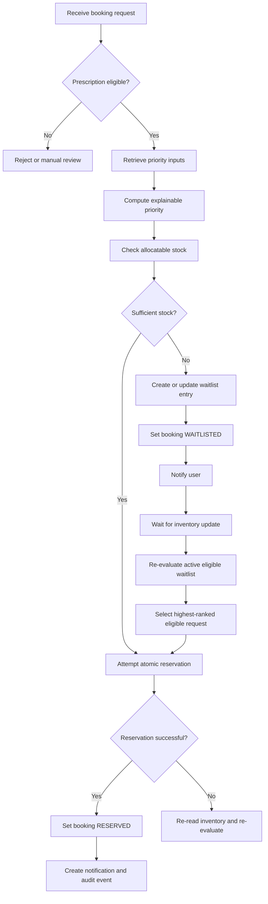
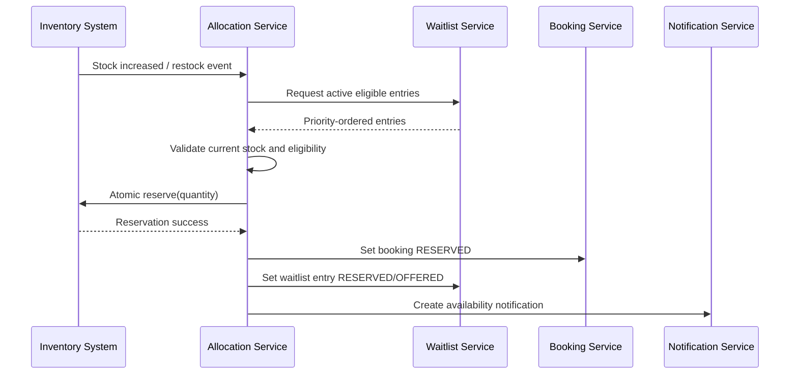
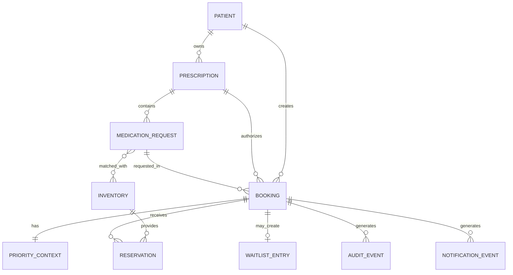
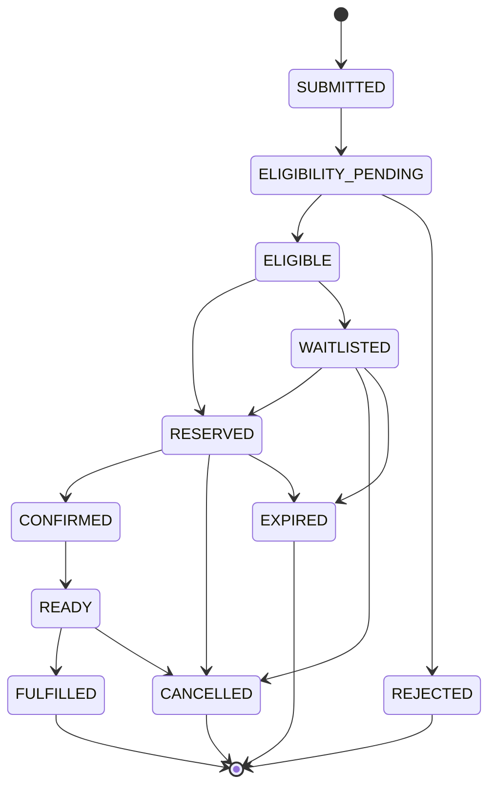

# PES UNIVERSITY, BANGALORE

## Department of Computer Science and Engineering

### Jackfruit Phase-1

---

# Software Requirements Specification

## Priority-Based Medicine Booking and Allocation Module for Pharma Apps

**Project ID:** 47  
**Version:** 1.0

## Team Details

| Project ID | Team Member | SRN |
|---|---|---|
| 47 | Paturu Naga Jignas | PES2UG24AM110 |
| 47 | Namit Krishna Renjith | PES2UG24AM097 |
| 47 | Mayank Kedia | PES2UG24AM088 |
| 47 | Mrudul M | PES2UG24AM094 |

**Prepared by:** Project Team  
**Organization:** PES University, Bangalore  
**Date:** 06 September 2026

---

# Table of Contents

1. [Introduction](#1-introduction)
   - [1.1 Purpose](#11-purpose)
   - [1.2 Intended Audience and Reading Suggestions](#12-intended-audience-and-reading-suggestions)
   - [1.3 Product Scope](#13-product-scope)
   - [1.4 References](#14-references)
2. [Overall Description](#2-overall-description)
   - [2.1 Product Perspective](#21-product-perspective)
   - [2.2 Product Functions](#22-product-functions)
   - [2.3 User Classes and Characteristics](#23-user-classes-and-characteristics)
   - [2.4 Operating Environment](#24-operating-environment)
   - [2.5 Design and Implementation Constraints](#25-design-and-implementation-constraints)
   - [2.6 Assumptions and Dependencies](#26-assumptions-and-dependencies)
3. [External Interface Requirements](#3-external-interface-requirements)
4. [Analysis Models](#4-analysis-models)
5. [System Features](#5-system-features)
   - [5.1 E-Prescription and Patient Context](#51-e-prescription-and-patient-context)
6. [Other Nonfunctional Requirements](#6-other-nonfunctional-requirements)
7. [Other Requirements](#7-other-requirements)
8. [Appendix A: Glossary](#appendix-a-glossary)
9. [Appendix B: Field Layouts](#appendix-b-field-layouts)
10. [Appendix C: Requirement Traceability Matrix](#appendix-c-requirement-traceability-matrix)

---

# Revision History

| Name | Date | Reason for Changes | Version |
|---|---|---|---|
| Paturu Naga Jignas | 06-09-2026 | Initial SRS content | 1.0 |

---

# 1. Introduction

## 1.1 Purpose

This Software Requirements Specification defines the requirements for Version 1.0 of the **Priority-Based Medicine Booking and Allocation Module for Pharma Apps**.

The system is designed as an integrable pharmacy workflow module that supports prescription-based medicine booking and the allocation of limited medicine stock among eligible requests.

The module uses the following information during the booking and allocation workflow:

- prescription information;
- current medicine availability;
- verified urgency;
- patient-history information relevant to continuity of therapy;
- waitlist state; and
- pharmacy allocation rules.

The system supports prescription handling, priority-based booking, medicine allocation, waitlist management, notifications, pharmacist intervention, and auditability.

The system does not diagnose medical conditions, prescribe medicines, or independently determine clinical urgency.

## 1.2 Intended Audience and Reading Suggestions

This document is intended for:

- project developers;
- project evaluators;
- software testers;
- pharmacists and pharmacy managers;
- system administrators; and
- developers responsible for integrating prescription, inventory, and notification services.

The SRS is organized into product description, interface requirements, analysis models, system features, nonfunctional requirements, other requirements, and supporting appendices.

## 1.3 Product Scope

The **Priority-Based Medicine Booking and Allocation Module for Pharma Apps** manages prescription-medicine requests when medicine availability is limited.

The system provides the following capabilities:

- receive uploaded or electronic prescriptions;
- record prescription validation status;
- associate prescriptions with patients;
- identify medicines requested through a prescription;
- obtain patient-history information required for allocation;
- create medicine bookings;
- check medicine availability;
- prioritize eligible medicine requests;
- reserve available stock;
- place unfulfilled requests on a waitlist;
- re-evaluate waitlisted requests when stock becomes available;
- send booking and waitlist notifications;
- support authorized pharmacist overrides; and
- maintain an audit trail of important decisions.

The module is intended for integration with pharmacy applications, hospital or clinic pharmacy systems, pharmacy chains, and e-pharmacy systems.

### Objectives

1. Provide a consistent method for processing limited medicine stock.
2. Prevent allocation beyond available inventory.
3. Maintain a transparent ordering of eligible requests.
4. Support continuity of medication where relevant patient history is available.
5. Automatically manage unfulfilled requests through a waitlist.
6. Provide pharmacists with controlled override capability.
7. Maintain traceability of prescription, booking, allocation, and waitlist decisions.

### Scope Exclusions

Version 1.0 does not include:

- medical diagnosis;
- medicine prescribing;
- autonomous emergency triage;
- payment processing;
- insurance processing;
- delivery-route optimization;
- a complete e-commerce pharmacy platform; or
- autonomous medicine substitution.

## 1.4 References

1. PES University, Department of Computer Science and Engineering, **JACKFRUIT - SE MINI-PROJECT GUIDELINES 2026**.
2. Ayushman Bharat Digital Mission, **ABDM Documentation and FAQ**.
3. NRCeS/NHA, **FHIR Implementation Guide for ABDM — MedicationRequest**.
4. NRCeS/NHA, **FHIR Implementation Guide for ABDM — PrescriptionRecord**.
5. Central Drugs Standard Control Organisation, **Drugs and Cosmetics Act, 1940 and Rules, 1945**.
6. Ministry of Health and Family Welfare, **Telemedicine Practice Guidelines**.
7. Ministry of Electronics and Information Technology, **Digital Personal Data Protection Rules, 2025**.

---

# 2. Overall Description

## 2.1 Product Perspective

The system is a software module intended to operate within or alongside an existing pharmacy application.

It focuses on the workflow between a prescription-based medicine request and medicine allocation. Existing systems may continue to manage medicine catalogs, payments, delivery, procurement, and other pharmacy operations.

The module may communicate with:

- a patient-facing pharmacy application;
- a pharmacist interface;
- an electronic-prescription source;
- a patient-record source;
- an inventory management system;
- a notification service; and
- an audit or reporting store.

The system shall use a deterministic and explainable allocation policy. Medicine availability shall be treated as an allocation constraint. Priority shall be determined from authorized and relevant inputs such as verified urgency, continuity-of-therapy information, and waiting time.

An authorized pharmacist shall be able to review and override a system decision when required.

## 2.2 Product Functions

### Prescription and Patient Context

The system shall:

- receive an uploaded prescription or supported electronic prescription;
- record prescription source and validation status;
- associate the prescription with the relevant patient;
- identify medicine requests in the prescription;
- obtain only the patient-history information required by the allocation policy; and
- record authorization information when required for access to external health records.

### Booking and Priority

The system shall:

- create medicine bookings;
- accept verified urgency only from an authorized source;
- calculate an explainable priority order;
- maintain the rules or reason codes used to determine priority; and
- use waiting time when resolving otherwise equivalent requests.

### Inventory and Allocation

The system shall:

- retrieve current allocatable inventory;
- reserve medicine stock;
- prevent allocation beyond available quantity;
- support the configured partial-allocation policy; and
- release reserved stock after cancellation or reservation expiry.

### Waitlist Management

The system shall:

- create a waitlist entry when an eligible request cannot be fulfilled;
- order active waitlist entries using the configured priority policy;
- re-evaluate the waitlist when stock changes;
- promote the highest-priority eligible request when stock becomes available; and
- remove or skip cancelled, expired, or otherwise ineligible requests.

### Notifications

The system shall:

- notify users when booking status changes;
- notify users when a request enters the waitlist;
- notify users when medicine becomes available and is reserved;
- notify users about reservation expiry or cancellation where applicable; and
- record notification status.

### Pharmacist Control and Audit

The system shall:

- allow authorized pharmacists to override applicable priority or allocation decisions;
- require a reason for an override;
- record the user, time, previous state, new state, and reason for an override; and
- support authorized review of allocation history.

## 2.3 User Classes and Characteristics

### 2.3.1 Patient / Caregiver

A patient or authorized caregiver may:

- provide or select a prescription;
- request prescribed medicines;
- view booking status;
- view waitlist status; and
- receive notifications.

The patient shall only access records and bookings for which they are authorized.

A patient shall not directly set or modify a verified urgency value used by the allocation system.

### 2.3.2 Pharmacist

A pharmacist is an authorized operational user who may:

- review prescriptions;
- validate prescription information;
- confirm operational urgency;
- review medicine availability;
- process medicine fulfilment;
- handle exceptional cases; and
- override applicable allocation decisions.

### 2.3.3 Pharmacy Manager

A pharmacy manager may:

- review allocation activity;
- inspect overrides;
- review waitlist and fulfilment information; and
- manage approved operational policies where authorized.

### 2.3.4 External Prescription System

An external prescription system may provide:

- patient identifiers;
- prescription metadata;
- medication requests; and
- prescription source identifiers.

### 2.3.5 Inventory System

An inventory system may provide:

- medicine identifiers;
- pharmacy or location identifiers;
- available stock quantities;
- reserved quantities;
- batch or expiry information; and
- stock-change events.

### 2.3.6 Notification Service

A notification service may deliver booking, waitlist, reservation, and cancellation notifications.

## 2.4 Operating Environment

The system shall be implementable as a web-based software module consisting of:

- browser-based user interfaces;
- an application or API service;
- persistent data storage;
- a prescription integration interface;
- an inventory integration interface; and
- a notification interface.

The final programming language, framework, database, deployment platform, and supporting tools shall be defined in the project plan.

External systems shall be accessed through defined interfaces so that test implementations or mock services can be used when a production integration is unavailable.

## 2.5 Design and Implementation Constraints

1. Prescription-required medicines shall require an acceptable prescription state before automatic allocation.
2. Patient-entered free text shall not directly determine verified urgency.
3. Only patient-history data required by the allocation policy shall be provided to the allocation process.
4. Medicine allocation shall prevent concurrent overselling.
5. Pharmacist overrides shall be recorded in the audit trail.
6. Restricted medicine categories may require manual pharmacist review or exclusion from the prototype.
7. The system shall not claim to diagnose, prescribe, or provide emergency medical care.
8. External prescription, inventory, and notification services shall be accessed through defined interfaces.
9. Health and prescription data shall be protected using appropriate authentication, authorization, secure communication, and data-minimization controls.
10. The design should permit structured electronic prescription integration compatible with relevant FHIR concepts.

## 2.6 Assumptions and Dependencies

### Assumptions

1. The pharmacy inventory system provides sufficiently current stock information.
2. Prescription validity can be determined through the configured validation workflow.
3. Verified urgency can be supplied or confirmed by an authorized user or system.
4. Patient-history information relevant to continuity of therapy can be represented using a limited set of attributes.
5. Every booking and prescription can be uniquely identified.
6. Inventory can be reserved and released through a controlled operation.

### Dependencies

The system depends on:

- prescription data;
- patient identity data;
- medicine catalog data;
- inventory data;
- authentication and authorization;
- persistent storage; and
- notification services.

The following policy values shall be configurable:

- urgency categories;
- reservation duration;
- partial-allocation behavior;
- notification channels; and
- pharmacy or branch scope.

---

# 3. External Interface Requirements

### 3.1 User Interfaces

The system shall provide role-appropriate interfaces for patients, pharmacists, and pharmacy managers.

#### 3.1.1 Patient Interface

The patient interface shall allow an authorized user to:

- submit or select a prescription;
- select medicines associated with a valid prescription;
- create a medicine booking;
- view the current booking status;
- view whether a request is allocated or waitlisted;
- view reservation expiry where applicable;
- cancel an eligible booking;
- receive clear status and error messages.

The patient interface shall not:

- expose another patient's identity, prescription, booking, or waitlist information;
- allow a patient to directly set or modify a verified urgency value;
- display internal allocation scores or sensitive patient-history attributes;
- imply that the application provides emergency medical care.

Patient-facing statuses shall use plain language corresponding to internal states such as:

- Prescription Under Review
- Prescription Accepted
- Prescription Rejected
- Booking Submitted
- Medicine Reserved
- Waitlisted
- Ready for Pickup / Fulfilment
- Cancelled
- Reservation Expired

#### 3.1.2 Pharmacist Interface

The pharmacist interface shall allow an authorized pharmacist to:

- search and review prescription-linked bookings;
- view prescription validation status;
- review medicine requests and requested quantities;
- confirm or assign an authorized urgency category according to pharmacy policy;
- view current inventory information;
- view the factors used by the priority policy;
- view the waitlist for a medicine without unnecessary patient information;
- approve or reject manual-review prescriptions;
- override an applicable priority or allocation decision;
- enter a mandatory reason for an override;
- mark a booking as ready, fulfilled, rejected, or cancelled where authorized.

The interface shall visually distinguish:

- system-generated priority;
- pharmacist-confirmed information;
- pharmacist overrides.

#### 3.1.3 Pharmacy Manager Interface

The pharmacy manager interface shall support authorized viewing of:

- active bookings;
- active waitlists;
- allocation history;
- pharmacist overrides;
- reservation expiry events;
- fulfilment metrics;
- notification delivery status.

Policy configuration capabilities, if implemented, shall be restricted to authorized users.

#### 3.1.4 Interface Validation and Error Handling

The system shall display validation messages when:

- a required prescription is missing;
- a prescription is invalid, expired, or awaiting review;
- a requested medicine is not associated with the prescription where such association is required;
- a requested quantity is invalid;
- a booking is duplicated;
- inventory is unavailable;
- a booking cannot be cancelled;
- an unauthorized action is attempted.

Error messages shall not expose stack traces, database details, authentication secrets, or sensitive patient information.

### 3.2 Software Interfaces

#### 3.2.1 Prescription Interface

The prescription interface shall support one or more of the following configured inputs:

- prescription document upload;
- structured internal prescription JSON;
- a FHIR-compatible prescription adapter.

The structured interface shall support mapping of:

- prescription identifier;
- patient identifier;
- prescription status;
- authored date;
- prescriber reference where available;
- medicine identifier;
- medicine name;
- requested quantity;
- source identifier.

A FHIR adapter may map relevant concepts from ABDM-compatible `MedicationRequest` and `PrescriptionRecord` structures into the internal model.

#### 3.2.2 Inventory Interface

The inventory interface shall provide, for a medicine and pharmacy location:

- medicine identifier;
- available or on-hand quantity;
- reserved quantity;
- allocatable quantity;
- batch information where available;
- expiry information where available;
- inventory status;
- last-updated timestamp.

The interface shall support inventory update or restock events.

Inventory operations used for allocation shall support a concurrency-safe reservation mechanism.

#### 3.2.3 Patient Context Interface

The patient-context interface shall provide only the attributes required by the configured allocation policy.

At minimum, the interface may provide:

- patient identifier;
- continuity-of-therapy indicator;
- context status such as AVAILABLE or UNKNOWN;
- source timestamp;
- authorization or consent reference where required.

The interface shall not provide unrelated medical history to the allocation component.

#### 3.2.4 Notification Interface

The notification interface shall support event requests containing:

- notification event identifier;
- recipient reference;
- channel;
- template identifier;
- booking identifier;
- non-sensitive template parameters;
- creation timestamp.

The notification service shall return or record delivery status.

#### 3.2.5 Authentication and Authorization Interface

The system shall integrate with an authentication mechanism capable of identifying:

- patient/caregiver;
- pharmacist;
- pharmacy manager;
- administrator.

Authorization shall be enforced server-side for protected operations.

### 3.3 Communications Interfaces

The system shall use HTTPS for communication between browser clients, application services, and external network services.

External APIs shall exchange structured data using JSON unless a selected integration requires another documented format.

The system shall:

- validate incoming API payloads;
- reject malformed requests;
- use authenticated requests for protected interfaces;
- apply configurable timeouts to external service calls;
- handle external service failures without corrupting booking or allocation state;
- prevent duplicate effects for retried idempotent operations where applicable.

Sensitive prescription and patient information shall not be included in URLs or query strings when avoidable.

Notification text sent through channels visible on device lock screens shall contain the minimum information necessary to communicate status.

---

# 4. Analysis Models

### 4.1 System Context Diagram

### 4.2 Medicine Booking and Allocation Activity Diagram

### 4.3 Waitlist Promotion Sequence

### 4.4 Entity Relationship Model

### 4.5 Booking State Model

---

# 5. System Features

## 5.1 E-Prescription and Patient Context

### 5.1.1 Description and Priority

The E-Prescription and Patient Context feature provides the prescription and patient information required by the medicine booking and allocation workflow.

The feature supports:

- prescription ingestion;
- prescription validation state;
- patient association;
- medication-request extraction or import;
- minimum required patient-history context; and
- traceability between prescription, patient, medicine request, and booking.

**Priority:** High

### 5.1.2 Stimulus/Response Sequences

#### A. Prescription Upload

1. The patient or pharmacist submits a supported prescription file.
2. The system assigns a unique prescription identifier.
3. The system records the prescription source.
4. The system validates the file against configured structural constraints.
5. The prescription enters the appropriate validation state.
6. After successful validation, the prescription becomes available for medicine booking.

#### B. Electronic Prescription Import

1. An external prescription system provides a supported structured prescription.
2. The system validates the input structure.
3. The system maps supported prescription and medication-request fields to the internal data model.
4. The system records the external source identifier where available.
5. The prescription enters the configured validation workflow.
6. A valid prescription becomes available for booking.

#### C. Invalid or Incomplete Prescription

1. A prescription is submitted or imported.
2. The system determines that required information is invalid, missing, expired, or requires manual review.
3. The system records the corresponding validation state.
4. The system records the reason for the validation result.
5. The system prevents automatic allocation where the prescription state does not permit allocation.

#### D. Patient Context Retrieval

1. An eligible booking requires priority evaluation.
2. The system identifies the relevant patient.
3. The system requests only the patient-history attributes required by the configured allocation policy.
4. The context provider returns the available value or an explicit unknown value.
5. The system provides the minimum required context to the priority-allocation process.

### 5.1.3 Functional Requirements

**REQ-EP-01:** The system shall assign a unique identifier to each prescription received by the system.

**REQ-EP-02:** The system shall record the source of each prescription.

**REQ-EP-03:** The system shall validate uploaded prescription files against configured file-type and file-size constraints.

**REQ-EP-04:** The system shall support at least the prescription states `RECEIVED`, `VALIDATION_PENDING`, `VALID`, `INVALID`, `EXPIRED`, and `MANUAL_REVIEW_REQUIRED`.

**REQ-EP-05:** The system shall prevent prescriptions in `INVALID` or `EXPIRED` state from being used for automatic medicine allocation.

**REQ-EP-06:** The system shall associate each prescription with one patient identity in the internal data model.

**REQ-EP-07:** The system shall store or reference one or more medication requests associated with a prescription.

**REQ-EP-08:** A medication request shall include a medicine identifier or medicine name and a requested quantity before it can enter allocation.

**REQ-EP-09:** The system shall record the prescription-authored date and prescriber reference when these values are available.

**REQ-EP-10:** The system shall provide an interface for mapping a supported structured electronic prescription into the internal prescription and medication-request model.

**REQ-EP-11:** The system shall reject a structured prescription payload that does not satisfy the configured input schema.

**REQ-EP-12:** When patient-history context is required for priority evaluation, the system shall retrieve only the attributes required by the configured allocation policy.

**REQ-EP-13:** When required patient-history information is unavailable, the system shall represent the value as `UNKNOWN` and shall not infer it from unrelated patient information.

**REQ-EP-14:** The system shall record authorization or consent metadata when required for access to an external health-record source.

**REQ-EP-15:** The system shall not provide unrelated patient-history information to the priority-allocation process.

**REQ-EP-16:** The system shall record a validation or rejection reason when a prescription cannot proceed automatically.

**REQ-EP-17:** The system shall maintain traceable relationships among patient, prescription, medication request, and resulting booking.

**REQ-EP-18:** The system shall support authorized manual review of prescriptions in `MANUAL_REVIEW_REQUIRED` state.

**REQ-EP-19:** The system shall timestamp prescription creation or import and every prescription validation-state change.

**REQ-EP-20:** The system shall preserve the source identifier of an imported electronic prescription when the source provides one.

## 5.2 Priority-Based Medicine Booking

## 5.2.1 Description and Priority

The Priority-Based Medicine Booking feature creates and maintains medicine bookings and determines the ordering of eligible requests when allocation decisions are required.

The feature shall use an explainable and deterministic policy based on authorized inputs.

The recommended ordering factors are:

1. eligibility;
2. verified urgency;
3. continuity-of-therapy context;
4. waiting time;
5. deterministic tie-breaking.

Medicine availability is treated as an allocation constraint and is evaluated by the allocation component.

A patient's commercial value, subscription status, payment value, or unrelated personal characteristics shall not influence medicine priority.

**Priority:** High

## 5.2.2 Stimulus/Response Sequences

### A. Create Eligible Booking

1. An authorized user selects a valid prescription.
2. The user selects an associated medicine request.
3. The user submits a booking request.
4. The system validates the prescription and booking information.
5. The system creates a unique booking identifier.
6. The booking enters eligibility evaluation.
7. The system obtains the configured priority inputs.
8. The system records a priority result and reason codes.
9. The booking is forwarded to allocation.

### B. Booking with Invalid Prescription

1. A user attempts to create a booking.
2. The associated prescription is invalid or expired.
3. The system rejects automatic booking progression.
4. The system records the reason.
5. The user receives an appropriate status message.

### C. Verified Urgency

1. A booking requires priority evaluation.
2. An authorized pharmacist or trusted source supplies or confirms an urgency category.
3. The system records the urgency value, source, actor, and timestamp.
4. The priority policy uses the verified urgency value.
5. The result and reason codes are stored.

### D. Missing Patient Context

1. A booking requires continuity-of-therapy context.
2. The patient-context source cannot provide the required value.
3. The system records the context as `UNKNOWN`.
4. The system applies the configured policy for unknown context.
5. The system does not infer medical history from unrelated data.

### E. Priority Re-Evaluation

1. A policy-relevant input changes.
2. The system determines that re-evaluation is required.
3. The priority policy is executed again.
4. The new result and policy version are stored.
5. The audit trail records the change.

### F. Equivalent Requests

1. Two or more eligible bookings have equivalent verified urgency and continuity context.
2. The system compares waiting time.
3. The older eligible booking is ordered before a newer equivalent booking.
4. If all configured factors remain equal, the configured deterministic tie-break rule is applied.

## 5.2.3 Functional Requirements

**REQ-PB-01:** The system shall assign a unique identifier to each medicine booking.

**REQ-PB-02:** The system shall associate each booking with one patient, one prescription, and at least one medicine request.

**REQ-PB-03:** The system shall prevent automatic progression of a booking when the associated prescription does not satisfy the configured eligibility policy.

**REQ-PB-04:** The system shall record the booking creation timestamp.

**REQ-PB-05:** The system shall maintain a booking status from the configured booking lifecycle.

**REQ-PB-06:** The system shall accept a verified urgency value only from an authorized user or trusted configured source.

**REQ-PB-07:** The patient-facing interface shall not permit a patient to directly modify a verified urgency value.

**REQ-PB-08:** The system shall record the source, actor, and timestamp associated with a verified urgency value when available.

**REQ-PB-09:** The priority policy shall use only configured and authorized input attributes.

**REQ-PB-10:** The priority policy shall include verified urgency as a ranking factor.

**REQ-PB-11:** The priority policy shall support a continuity-of-therapy value as a ranking factor.

**REQ-PB-12:** The priority policy shall support an explicit `UNKNOWN` continuity value.

**REQ-PB-13:** The priority policy shall use booking waiting time to order otherwise equivalent eligible requests.

**REQ-PB-14:** The system shall apply a deterministic tie-break rule when all configured ranking factors are equivalent.

**REQ-PB-15:** The system shall record the policy version used for each priority evaluation.

**REQ-PB-16:** The system shall record one or more reason codes explaining the factors that determined the priority result.

**REQ-PB-17:** An authorized pharmacist shall be able to view the reason codes associated with a booking priority.

**REQ-PB-18:** The system shall re-evaluate priority when a configured policy-relevant input changes.

**REQ-PB-19:** The system shall timestamp each priority evaluation.

**REQ-PB-20:** The system shall preserve the previous and new priority result when a priority change is auditable.

**REQ-PB-21:** The priority policy shall not use purchase value, customer lifetime value, subscription tier, marketing engagement, or payment amount as medicine-priority factors.

**REQ-PB-22:** The priority policy shall not use unrelated protected or personal characteristics as ranking factors.

**REQ-PB-23:** The system shall prevent a booking in `CANCELLED`, `REJECTED`, `FULFILLED`, or `EXPIRED` state from participating in active priority ordering.

**REQ-PB-24:** The system shall reject a booking request with a non-positive requested quantity.

**REQ-PB-25:** The system shall detect a configurable duplicate-booking condition before creating a second equivalent active request.

**REQ-PB-26:** When a duplicate active booking is detected, the system shall reject or flag the request according to configured policy.

**REQ-PB-27:** The system shall provide the allocation component with the booking identifier, medicine request, current eligibility state, and priority result.

**REQ-PB-28:** The system shall not expose other patients' priority inputs or health information to a patient viewing their own booking.

**REQ-PB-29:** The patient interface shall display a plain-language booking status.

**REQ-PB-30:** The system shall record a reason when a booking is rejected before allocation.

## 5.3 Medicine Allocation and Waitlist Management

## 5.3.1 Description and Priority

The Medicine Allocation and Waitlist Management feature determines whether eligible medicine bookings can be fulfilled from current allocatable stock.

When sufficient stock is available, the system shall reserve inventory using a concurrency-safe operation.

When sufficient stock is unavailable, the system shall maintain an ordered waitlist and automatically reconsider eligible waitlisted requests when inventory increases.

The allocation component shall use the priority result produced by the priority-booking component but shall independently verify current booking eligibility and inventory before reservation.

**Priority:** High

## 5.3.2 Stimulus/Response Sequences

### A. Successful Allocation

1. An eligible booking reaches the allocation component.
2. The system obtains current allocatable stock.
3. The requested quantity is available.
4. The system attempts an atomic stock reservation.
5. The inventory service confirms the reservation.
6. The booking enters `RESERVED` state.
7. The reservation expiry time is recorded where configured.
8. Allocation and inventory events are written to the audit trail.
9. A notification event is created.

### B. Insufficient Stock

1. An eligible booking reaches allocation.
2. The system determines that stock is insufficient.
3. The system creates an active waitlist entry.
4. The booking enters `WAITLISTED` state.
5. The waitlist entry is ordered using the current priority policy.
6. The system creates a waitlist notification.

### C. Restock

1. Inventory for a waitlisted medicine increases.
2. The system identifies active waitlist entries for the medicine and location.
3. The system removes or ignores entries that are no longer eligible.
4. The system orders remaining entries using current priority.
5. The system attempts to reserve stock for the highest-ranked eligible request.
6. On success, the booking becomes `RESERVED`.
7. Remaining stock, if any, is processed against the next eligible request.

### D. Concurrent Request for Last Available Unit

1. Two eligible bookings attempt to reserve the same final available quantity.
2. Both requests read an allocation opportunity.
3. The inventory reservation mechanism serializes or atomically validates the operation.
4. Only one reservation succeeds.
5. The unsuccessful booking is re-evaluated against current stock.
6. If stock is insufficient, the booking becomes or remains waitlisted.

### E. Reservation Expiry

1. A booking has reserved stock.
2. The reservation expiry time is reached without fulfilment or configured confirmation.
3. The system releases the reserved quantity.
4. The booking enters the configured expiry or waitlist state.
5. The system triggers re-evaluation of the relevant waitlist.
6. The released stock may be reserved for the next eligible booking.

### F. Cancellation

1. A patient or authorized user cancels an eligible booking.
2. If the booking has reserved stock, the reservation is released.
3. If the booking has an active waitlist entry, the waitlist entry becomes cancelled.
4. The booking enters `CANCELLED`.
5. Relevant waiting requests are re-evaluated if stock was released.

## 5.3.3 Functional Requirements

**REQ-AW-01:** The system shall obtain current allocatable stock before attempting medicine allocation.

**REQ-AW-02:** Allocatable stock shall exclude quantity already reserved for other active bookings.

**REQ-AW-03:** Inventory marked expired, quarantined, recalled, or otherwise non-allocatable shall not be allocated.

**REQ-AW-04:** The system shall reserve stock using a concurrency-safe operation.

**REQ-AW-05:** The system shall prevent the total active reserved quantity from exceeding allocatable inventory.

**REQ-AW-06:** The system shall record the inventory location associated with an allocation.

**REQ-AW-07:** The system shall record the quantity reserved for a booking.

**REQ-AW-08:** The system shall record batch and expiry information for a reservation when the inventory source provides such information.

**REQ-AW-09:** The system shall set an allocated booking to `RESERVED` after successful inventory reservation.

**REQ-AW-10:** The system shall create a waitlist entry when an eligible booking cannot be allocated because of insufficient stock.

**REQ-AW-11:** Each waitlist entry shall be uniquely identifiable.

**REQ-AW-12:** Each waitlist entry shall reference the associated booking, medicine, pharmacy location, and waitlist-entry timestamp.

**REQ-AW-13:** The system shall order active waitlist entries according to the currently configured priority policy.

**REQ-AW-14:** The system shall not include cancelled, rejected, fulfilled, expired, or otherwise ineligible bookings in active waitlist ordering.

**REQ-AW-15:** The system shall re-evaluate relevant active waitlist entries after a stock-increase event.

**REQ-AW-16:** The system shall attempt allocation for the highest-ranked currently eligible waitlist entry before a lower-ranked eligible entry for the same medicine and location.

**REQ-AW-17:** The system shall revalidate current prescription and booking eligibility before promoting a waitlisted request.

**REQ-AW-18:** The system shall re-read or validate current inventory before each reservation attempt triggered by waitlist promotion.

**REQ-AW-19:** If a waitlisted request is no longer eligible, the system shall skip or remove it according to configured policy and continue evaluation.

**REQ-AW-20:** The system shall release reserved stock when a booking is cancelled before fulfilment.

**REQ-AW-21:** The system shall support a configurable reservation-expiry duration.

**REQ-AW-22:** The system shall release reserved stock when a reservation expires according to configured policy.

**REQ-AW-23:** Releasing stock from a cancellation or expiry shall trigger re-evaluation of relevant active waitlist entries.

**REQ-AW-24:** The system shall support a configurable partial-allocation policy.

**REQ-AW-25:** When partial allocation is disabled, the system shall not reserve less than the requested quantity.

**REQ-AW-26:** When partial allocation is enabled, the system shall record the allocated quantity and remaining unfulfilled quantity separately.

**REQ-AW-27:** The system shall prevent the same requested quantity from being simultaneously fulfilled and actively waitlisted.

**REQ-AW-28:** The system shall preserve waitlist state history required for audit.

**REQ-AW-29:** The system shall record the time at which a waitlist entry is promoted or offered stock.

**REQ-AW-30:** The system shall support an idempotent inventory-restock event identifier or equivalent duplicate-event protection.

**REQ-AW-31:** Processing the same restock event more than once shall not duplicate a valid reservation.

**REQ-AW-32:** The system shall detect and recover from a failed reservation attempt by re-reading current inventory state.

**REQ-AW-33:** Notification failure shall not reverse a successfully completed stock reservation.

**REQ-AW-34:** The system shall record allocation success, allocation failure, stock release, waitlist entry, and waitlist promotion as auditable events.

**REQ-AW-35:** A patient viewing waitlist status shall not be shown the identity, prescription, health information, or exact priority inputs of other patients.

## 5.4 Notification Management

### 5.4.1 Description and Priority

The Notification Management feature communicates important booking, allocation, waitlist, reservation, and cancellation events to authorized users.

Notifications shall communicate operational status without unnecessarily exposing medicine names, diagnoses, or other health information on channels that may be visible to third parties.

Notification delivery shall be separated from the correctness of the core booking and allocation transaction. Failure of a notification provider shall not undo a valid medicine reservation.

**Priority:** Medium

### 5.4.2 Stimulus/Response Sequences

#### A. Booking Confirmation

1. A booking is successfully created.
2. The system creates a booking-confirmation notification event.
3. The notification service attempts delivery through the configured channel.
4. The system records delivery status.

#### B. Waitlist Entry

1. An eligible booking cannot be allocated.
2. The booking enters `WAITLISTED`.
3. The system creates a waitlist-status notification.
4. The notification is delivered using a neutral template.
5. Delivery result is recorded.

#### C. Medicine Reserved After Restock

1. A waitlisted request is promoted.
2. Stock is successfully reserved.
3. The booking enters `RESERVED`.
4. The system creates an availability/reservation notification.
5. The user is informed of the reservation expiry where applicable.

#### D. Notification Failure

1. A valid notification event is created.
2. The external notification provider fails or times out.
3. The system records a failed or pending delivery state.
4. The booking/allocation state remains unchanged.
5. The system may retry according to configured policy.

### 5.4.3 Functional Requirements

**REQ-NT-01:** The system shall create a notification event when a booking is successfully submitted.

**REQ-NT-02:** The system shall create a notification event when a booking enters `WAITLISTED`.

**REQ-NT-03:** The system shall create a notification event when medicine stock is successfully reserved for a booking.

**REQ-NT-04:** The system shall include reservation expiry information in the applicable reservation notification.

**REQ-NT-05:** The system shall create a notification event when a booking is cancelled.

**REQ-NT-06:** The system shall create a notification event when a booking is rejected where user notification is applicable.

**REQ-NT-07:** The system shall support at least one configured notification channel.

**REQ-NT-08:** The system shall record the notification channel used for each delivery attempt.

**REQ-NT-09:** The system shall record notification delivery status.

**REQ-NT-10:** The system shall timestamp notification creation and delivery attempts.

**REQ-NT-11:** Notification content shall use configurable templates.

**REQ-NT-12:** Notification templates intended for channels visible on lock screens shall avoid unnecessary diagnosis, prescription, or medicine details.

**REQ-NT-13:** Failure of a notification-delivery attempt shall not roll back a completed booking or inventory reservation.

**REQ-NT-14:** The system shall support retry of a failed notification according to configured policy.

**REQ-NT-15:** The system shall prevent one user from receiving another user's booking notification.

---

# 6. Other Nonfunctional Requirements

## 6.1 Performance Requirements

**NFR-P-01:** Under the agreed prototype test load, at least 95% of internal booking-status retrieval requests shall complete within 1 second, excluding external-service latency.

**NFR-P-02:** Under the agreed prototype test load, at least 95% of booking-submission requests shall complete within 2 seconds, excluding external prescription, inventory, or notification-service latency.

**NFR-P-03:** Under the agreed prototype dataset size, a valid inventory-restock event shall trigger relevant waitlist re-evaluation within 3 seconds.

**NFR-P-04:** The inventory-reservation operation shall be concurrency-safe when multiple bookings compete for the same remaining stock.

**NFR-P-05:** The system shall support configurable timeouts for external-service calls.

**NFR-P-06:** A timeout or failure of a non-critical notification service shall not block completion of a valid inventory transaction.

## 6.2 Safety Requirements

**NFR-SF-01:** The system shall not diagnose medical conditions.

**NFR-SF-02:** The system shall not prescribe medicines.

**NFR-SF-03:** The system shall not independently infer clinical urgency from patient-entered free text.

**NFR-SF-04:** Verified urgency used for priority shall originate from an authorized user or trusted configured source.

**NFR-SF-05:** The patient interface shall not imply that the system replaces emergency medical services.

**NFR-SF-06:** Where an emergency indicator is presented, the interface shall direct the user to appropriate emergency-care guidance defined by the product owner instead of relying on medicine waitlist fulfilment.

**NFR-SF-07:** Prescription-required medicines shall not be automatically allocated when the prescription state is invalid or expired.

**NFR-SF-08:** Restricted medicine categories configured for manual review shall not be automatically allocated without the required review.

**NFR-SF-09:** The system shall prevent allocation of inventory marked expired, quarantined, recalled, or otherwise non-allocatable.

**NFR-SF-10:** Pharmacist overrides shall be attributable to an authenticated authorized user.

## 6.3 Security Requirements

**NFR-SEC-01:** Network communication containing authentication, prescription, patient, booking, or inventory-reservation data shall use HTTPS/TLS.

**NFR-SEC-02:** The system shall enforce authenticated access to protected patient, pharmacist, manager, and administrative functionality.

**NFR-SEC-03:** The system shall enforce role-based authorization on the server side.

**NFR-SEC-04:** A patient shall not be authorized to read or modify another patient's prescription or booking.

**NFR-SEC-05:** Only authorized pharmacy users shall be able to validate prescriptions, confirm verified urgency, or override allocation decisions.

**NFR-SEC-06:** Passwords, when managed by the system, shall be stored using a salted password-hashing algorithm.

**NFR-SEC-07:** Sensitive patient and prescription data stored by the application shall be encrypted at rest where supported by the selected deployment platform.

**NFR-SEC-08:** The system shall validate API request schemas and uploaded-file constraints before processing.

**NFR-SEC-09:** Database operations shall use parameterized queries or equivalent protections against injection.

**NFR-SEC-10:** Authentication tokens or sessions shall have configurable expiry.

**NFR-SEC-11:** Sensitive information shall not be included in application logs unless explicitly required and protected.

**NFR-SEC-12:** Audit events shall record security-relevant administrative and override actions.

**NFR-SEC-13:** The system shall reject unauthorized object-level access even when a valid booking or prescription identifier is supplied.

**NFR-SEC-14:** External API credentials shall not be stored directly in source-code repositories.

**NFR-SEC-15:** Error responses shall not expose stack traces, database credentials, tokens, or internal secrets to end users.

## 6.4 Software Quality Attributes

### Reliability

**NFR-QA-01:** Inventory reservation and booking-state update shall be implemented so that a partial failure does not produce an allocated booking without a corresponding valid reservation.

**NFR-QA-02:** Retried idempotent events shall not create duplicate reservations.

**NFR-QA-03:** Every booking-state transition shall be timestamped.

### Availability

**NFR-QA-04:** Failure of the external notification service shall not make booking and allocation functions unavailable.

**NFR-QA-05:** External integration failures shall produce controlled error states rather than application crashes.

### Maintainability

**NFR-QA-06:** Priority-policy logic shall be separated from presentation-layer code.

**NFR-QA-07:** Prescription, inventory, patient-context, and notification integrations shall use defined adapter/service interfaces.

**NFR-QA-08:** Configurable policy values shall not require modification of unrelated application modules.

### Testability

**NFR-QA-09:** Each functional requirement shall be traceable to one or more test cases before final validation.

**NFR-QA-10:** External dependencies shall support mock or test implementations.

**NFR-QA-11:** The system shall provide deterministic test fixtures for priority-ordering tests.

### Usability

**NFR-QA-12:** Patient-facing status messages shall use plain language.

**NFR-QA-13:** The pharmacist interface shall display the reason factors used by the priority system.

**NFR-QA-14:** A pharmacist override shall be visually distinguishable from the original system decision.

### Auditability

**NFR-QA-15:** Important prescription-validation, priority, allocation, waitlist, override, and fulfilment events shall be auditable.

**NFR-QA-16:** An audit event shall include at least actor or system source, event type, object identifier, and timestamp.

## 6.5 Business Rules

**BR-01:** Prescription-required medicines shall require an acceptable prescription state before automatic allocation.

**BR-02:** A patient shall not directly assign or modify verified urgency.

**BR-03:** Reserved inventory shall not be counted as allocatable inventory for another booking.

**BR-04:** Expired, recalled, quarantined, or otherwise blocked inventory shall not be allocated.

**BR-05:** A booking shall not be simultaneously fulfilled and actively waitlisted for the same unfulfilled quantity.

**BR-06:** A pharmacist override shall require a reason.

**BR-07:** Customer purchase value, loyalty status, subscription tier, marketing engagement, and payment amount shall not influence medicine allocation priority.

**BR-08:** A cancelled booking shall release any active stock reservation associated with the cancelled quantity.

**BR-09:** An expired reservation shall release stock according to configured policy.

**BR-10:** Waitlist promotion shall use the currently effective eligibility and priority policy.

**BR-11:** Restricted medicine categories may be excluded from automatic allocation or routed to manual pharmacist review.

**BR-12:** The software shall not perform autonomous prescribing or medicine substitution.

**BR-13:** Patient-history information used by priority shall be limited to the minimum attributes required by policy.

**BR-14:** Every pharmacist override shall be included in the audit trail.

---

# 7. Other Requirements

## 7.1 Data and Privacy Requirements

**OR-01:** Patient and prescription data shall be collected and processed only for defined application purposes.

**OR-02:** The allocation component shall receive only the minimum patient context required by the configured policy.

**OR-03:** The system shall support configurable data-retention periods by data category.

**OR-04:** Where an external digital-health-record workflow requires authorization or consent, the system shall record the corresponding authorization reference or status.

**OR-05:** Patient-facing waitlist information shall not reveal information about other patients.

**OR-06:** Notification templates shall minimize sensitive health information.

## 7.2 Interoperability Requirements

**OR-07:** The system shall use stable internal identifiers for patients, prescriptions, medicine requests, bookings, waitlist entries, and reservations.

**OR-08:** The prescription integration design shall permit mapping from structured electronic prescription data.

**OR-09:** The structured prescription adapter should support concepts corresponding to FHIR `MedicationRequest` and ABDM `PrescriptionRecord`.

**OR-10:** External-service adapters shall document required fields, authentication method, expected responses, and failure behavior.

## 7.3 Logging and Audit Requirements

**OR-11:** The system shall maintain audit records for prescription-validation state changes.

**OR-12:** The system shall maintain audit records for verified urgency assignment or change.

**OR-13:** The system shall maintain audit records for priority evaluation.

**OR-14:** The system shall maintain audit records for stock reservation and stock release.

**OR-15:** The system shall maintain audit records for waitlist entry and promotion.

**OR-16:** The system shall maintain audit records for pharmacist overrides.

**OR-17:** Audit records shall be accessible only to authorized users.

---

# Appendix A: Glossary

| Term | Definition |
|---|---|
| ABDM | Ayushman Bharat Digital Mission |
| Allocation | Reservation or assignment of available medicine stock to an eligible booking |
| Allocatable Stock | Stock available for reservation after existing reservations and stock constraints |
| Continuity of Therapy | Ongoing use of a medicine where interruption may be relevant to allocation policy |
| E-Prescription | Prescription information represented electronically |
| FHIR | Fast Healthcare Interoperability Resources |
| Medication Request | A request or order for a medicine associated with a prescription |
| Patient Context | Minimum patient information required by the allocation policy |
| Priority Policy | Rules used to order eligible medicine requests |
| Verified Urgency | Urgency value supplied or confirmed through an authorized workflow |
| Waitlist | Ordered collection of eligible requests that cannot currently be allocated |
| TBD | To Be Determined |

---

# Appendix B: Field Layouts

## B.1 Patient

| Field | Data Type | Description | Mandatory |
|---|---|---|---|
| patient_id | UUID/String | Internal patient identifier | Y |
| external_patient_id | String | External patient/health-record identifier | N |
| display_name | String | Patient display name | Y |
| contact_reference | String | Notification contact reference | N |
| consent_status | Enum | External-record authorization status | N |
| created_at | Timestamp | Record creation time | Y |

## B.2 Prescription

| Field | Data Type | Description | Mandatory |
|---|---|---|---|
| prescription_id | UUID | Internal prescription identifier | Y |
| patient_id | Reference | Associated patient | Y |
| source | Enum | Upload, structured import, manual | Y |
| source_identifier | String | External source ID | N |
| status | Enum | Prescription validation state | Y |
| authored_on | Date/Time | Prescription authored time | N |
| prescriber_reference | String | Prescriber identifier/reference | N |
| validation_reason | String/Code | Validation result reason | N |
| created_at | Timestamp | Import/upload time | Y |

## B.3 Medication Request

| Field | Data Type | Description | Mandatory |
|---|---|---|---|
| medication_request_id | UUID | Internal request ID | Y |
| prescription_id | Reference | Parent prescription | Y |
| medicine_code | String | Medicine identifier | Y |
| medicine_name | String | Medicine display name | Y |
| requested_quantity | Number | Requested quantity | Y |
| dosage_text | String | Prescription dosage text if available | N |
| request_status | Enum | Request lifecycle state | Y |

## B.4 Booking

| Field | Data Type | Description | Mandatory |
|---|---|---|---|
| booking_id | UUID | Booking identifier | Y |
| patient_id | Reference | Booking owner | Y |
| prescription_id | Reference | Authorizing prescription | Y |
| medication_request_id | Reference | Requested medicine | Y |
| requested_quantity | Number | Quantity requested | Y |
| booking_state | Enum | Booking lifecycle state | Y |
| created_at | Timestamp | Booking creation time | Y |
| updated_at | Timestamp | Last state update | Y |

## B.5 Priority Context

| Field | Data Type | Description | Mandatory |
|---|---|---|---|
| booking_id | Reference | Associated booking | Y |
| verified_urgency | Enum | Authorized urgency category | Y |
| urgency_source | String/Reference | Source of urgency value | Y |
| continuity_status | Enum | Continuity-of-therapy context | Y |
| waiting_since | Timestamp | Time used for waiting-order calculation | Y |
| policy_version | String | Priority policy version | Y |
| reason_codes | Array | Explainability reason codes | Y |
| evaluated_at | Timestamp | Priority evaluation time | Y |

## B.6 Inventory

| Field | Data Type | Description | Mandatory |
|---|---|---|---|
| inventory_id | UUID | Inventory record ID | Y |
| medicine_code | String | Medicine identifier | Y |
| location_id | String | Pharmacy/location | Y |
| batch_id | String | Batch identifier | N |
| on_hand_quantity | Number | Quantity physically/system recorded | Y |
| reserved_quantity | Number | Quantity actively reserved | Y |
| expiry_date | Date | Batch expiry | N |
| inventory_state | Enum | In stock, quarantined, expired, etc. | Y |
| updated_at | Timestamp | Inventory update time | Y |

## B.7 Waitlist Entry

| Field | Data Type | Description | Mandatory |
|---|---|---|---|
| waitlist_id | UUID | Waitlist entry identifier | Y |
| booking_id | Reference | Associated booking | Y |
| medicine_code | String | Medicine identifier | Y |
| location_id | String | Pharmacy/location | Y |
| state | Enum | Waitlist state | Y |
| entered_at | Timestamp | Waitlist entry time | Y |
| offered_at | Timestamp | Promotion/offer time | N |
| reservation_expires_at | Timestamp | Reservation deadline | N |

## B.8 Audit Event

| Field | Data Type | Description | Mandatory |
|---|---|---|---|
| audit_id | UUID | Audit event identifier | Y |
| actor_id | String | User/system actor | Y |
| actor_role | Enum | Actor role | Y |
| event_type | String/Code | Event classification | Y |
| object_type | String | Affected entity type | Y |
| object_id | String | Affected entity ID | Y |
| previous_state | JSON/String | Previous state where applicable | N |
| new_state | JSON/String | New state where applicable | N |
| reason | String/Code | Reason where applicable | N |
| timestamp | Timestamp | Event time | Y |

## B.9 Notification Event

| Field | Data Type | Description | Mandatory |
|---|---|---|---|
| notification_id | UUID | Notification event ID | Y |
| booking_id | Reference | Associated booking | Y |
| recipient_reference | String | Recipient reference | Y |
| channel | Enum | Notification channel | Y |
| template_id | String | Template identifier | Y |
| delivery_status | Enum | Pending, sent, failed, etc. | Y |
| created_at | Timestamp | Event creation time | Y |
| delivered_at | Timestamp | Successful delivery time | N |

---

# Appendix C: Requirement Traceability Matrix — Additional Requirements

| Sl. No. | Requirement ID | Brief Description of Requirement | Architecture Reference | Design Reference | Code File Reference | Test Case ID | System Test Case ID |
|---:|---|---|---|---|---|---|---|
| 21 | REQ-PB-01 | Unique booking ID | TBD | TBD | TBD | TBD | TBD |
| 22 | REQ-PB-06 | Authorized verified urgency | TBD | TBD | TBD | TBD | TBD |
| 23 | REQ-PB-10 | Use urgency in ranking | TBD | TBD | TBD | TBD | TBD |
| 24 | REQ-PB-11 | Use continuity context | TBD | TBD | TBD | TBD | TBD |
| 25 | REQ-PB-13 | Use waiting time | TBD | TBD | TBD | TBD | TBD |
| 26 | REQ-PB-16 | Store priority reason codes | TBD | TBD | TBD | TBD | TBD |
| 27 | REQ-AW-01 | Check allocatable stock | TBD | TBD | TBD | TBD | TBD |
| 28 | REQ-AW-04 | Concurrency-safe reservation | TBD | TBD | TBD | TBD | TBD |
| 29 | REQ-AW-10 | Create waitlist entry | TBD | TBD | TBD | TBD | TBD |
| 30 | REQ-AW-15 | Re-evaluate waitlist on restock | TBD | TBD | TBD | TBD | TBD |
| 31 | REQ-AW-20 | Release stock on cancellation | TBD | TBD | TBD | TBD | TBD |
| 32 | REQ-AW-22 | Release expired reservation | TBD | TBD | TBD | TBD | TBD |
| 33 | REQ-NT-01 | Booking notification | TBD | TBD | TBD | TBD | TBD |
| 34 | REQ-NT-03 | Reservation notification | TBD | TBD | TBD | TBD | TBD |
| 35 | REQ-NT-09 | Record delivery status | TBD | TBD | TBD | TBD | TBD |
| 36 | NFR-SEC-03 | Server-side RBAC | TBD | TBD | TBD | TBD | TBD |
| 37 | NFR-SF-03 | No autonomous urgency inference | TBD | TBD | TBD | TBD | TBD |
| 38 | NFR-QA-09 | Requirement-to-test traceability | TBD | TBD | TBD | TBD | TBD |
