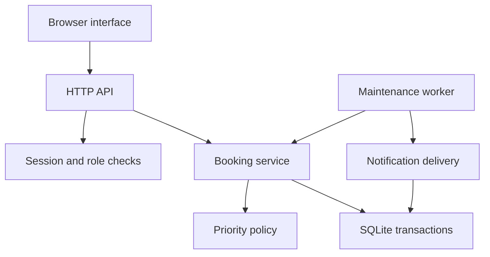

# Software Engineering Record

**Project:** MediNest — Priority-Based Medicine Booking and Allocation Module

**Requirements baseline:** [SRS v1.0](../SRS.md), Project ID 47

**Record date:** 2026-11-16

This document records the current implementation and verification approach. It does not reconstruct past sprint activity or claim approval of work that has not been reviewed. The original SRS remains the sole requirements specification; its 178 requirement statements are unchanged.

## 1. Lifecycle status

| Stage | Deliverable / evidence | Current status |
|---|---|---|
| Requirements analysis | SRS Sections 1–7, roles, safety boundaries, and acceptance behavior | Baseline retained; external integration and deployment gaps identified in Appendix C |
| Design | Architecture, persistence, state handling, and decisions below; SRS analysis models | Implementation design documented |
| Implementation | `src/medicine_booking/`, `run.py`, and static browser interface | Local application implemented |
| Verification | Automated tests, repeatable verification command, JUnit and coverage output | See the measured [verification report](TEST_REPORT.md) |
| Validation | Desktop patient and pharmacist inspection; acceptance checklist below | Partial; formal user acceptance, mobile and accessibility checks remain open |
| Delivery | Setup instructions, isolated sample fixtures, CI workflow, versioned commits | Local run verified; remote publication and CI execution pending |
| Maintenance | Configuration, data management, defect handling, and regression process below | Procedure documented; operational deployment pending |

## 2. Implementation architecture



Protected API requests must pass session, CSRF, role, and ownership checks before an application operation. The diagram shows dependencies, rather than suggesting an optional authorization path. The maintenance worker handles reservation expiry and delivery independently of browser refreshes.

| Component | Responsibility |
|---|---|
| `access.py` | Salted PBKDF2 passwords, expiring sessions, role and ownership guards |
| `domain.py` | Shared input validation, stable identifiers, UTC timestamps |
| `storage.py` | SQLite schema, foreign keys, quantity constraints, serialized transactions |
| `priority.py` | Verified urgency, continuity, waiting time, and deterministic tie-breaking |
| `booking.py` | Prescription intake and review, eligibility, reservation, waitlist, collection and audit |
| `notifications.py` | Persistent outbox, provider interface, delivery result and controlled retry |
| `server.py` | Loopback HTTP API, request validation, static delivery and background maintenance |
| `static/` | Role-specific views, plain-language statuses, forms and staff decision factors |
| `seed.py` | Explicitly enabled synthetic fixtures; no real patient integration |

### Data relationships and invariants

- A patient owns prescriptions; each prescription has one or more medication requests.
- Each booking references one request and its patient. At most one active booking may exist per request. Previously fulfilled quantity is counted against the prescribed limit.
- Inventory is tracked by medicine, location and batch. Reservation items link bookings to specific batches. Reserved quantity cannot be negative or exceed on-hand quantity.
- An active waitlist entry represents only a booking's unreserved quantity. Full reservation closes the active entry; fulfilment cannot leave the same quantity actively waitlisted.
- State changes and stock decisions produce timestamped audit records. Overrides preserve the actor, reason and previous/new decision.
- Notification events are committed with booking changes. Delivery results are recorded separately; provider failure cannot reverse an inventory transaction.

SQLite `BEGIN IMMEDIATE` serializes allocation writers. Booking, inventory, reservation, waitlist, audit and outbox changes share a transaction. A failure rolls them back together. Restock event identifiers and their payloads persist, allowing safe replay and rejecting a conflicting replay.

### Design decisions

| Decision | Reason | Consequence / limit |
|---|---|---|
| Python standard library and browser JavaScript | Keep local execution reproducible without a dependency installation step | The built-in server is restricted to loopback; internet deployment requires an appropriate server and TLS |
| SQLite with transactional allocation | Provide persistence and demonstrable concurrency safety for this project | Distributed pharmacy inventory and multi-instance operation require an integration design |
| Earliest-expiring eligible batches first | Record batch provenance while limiting avoidable stock expiry | Expired, recalled, quarantined and blocked batches remain excluded |
| Pharmacist-verified urgency and continuity | Keep clinical inputs attributable and prevent inference from patient text | Unknown context stays explicit; there is no connected health-record provider |
| Separate notification outbox | Keep allocation correct during notification failure | Only in-app delivery is configured; external providers need their own bounded network timeout |
| Partial allocation off by default | Use a predictable complete-request policy | When enabled, the full remaining quantity must be reserved before collection readiness |
| One original SRS with traceability in Appendix C | Keep requirements and implementation evidence connected without duplicate specifications | A test reference is limited to its actual assertions; it is not automatic proof of every clause |

### Lifecycle transitions

| Object | Trigger | Result and inventory effect |
|---|---|---|
| Prescription | Accepted structural intake | Received and validation-pending events; manual review or expiry state |
| Prescription | Pharmacist review | Accepted, rejected, expired or retained for review; affected active bookings re-evaluated |
| Booking | Valid submission with sufficient eligible stock | Reserved with batch allocation and collection deadline |
| Booking | Insufficient stock | Waitlisted; partial reservation allowed only when configured |
| Booking | Restock or stock release | Current eligibility and priority re-evaluated before promotion |
| Booking | Pharmacist marks ready and confirms collection | Ready → fulfilled; reserved units consumed |
| Booking | Authorized cancellation | Cancelled; reserved units released and queue reconsidered |
| Booking | Deadline reached | Expired; reserved units released and waitlist closed |
| Inventory | Recall, quarantine, block or expiry | Affected reservations released and eligible requests reconsidered |

## 3. Verification plan

### Scope and entry criteria

The test object is the current local application: service logic, SQLite transaction behavior, HTTP contracts, authorization, notification isolation, traceability and small-dataset response times. Entry requires Python 3.11+, a checkout containing the original SRS and tests, and Node.js for JavaScript syntax validation. All test data is synthetic and uses isolated temporary databases.

### Test design

| Area | Technique / cases | Primary evidence |
|---|---|---|
| Prescription intake | Valid structured input; missing or unsupported fields; unknown medicine; invalid quantity; duplicate source; file extension, signature and size boundaries | `test_booking.py` intake and upload cases |
| Booking and priority | Valid and duplicate requests; quantity limits; urgency, continuity, waiting time and ID ties; re-evaluation; terminal-state exclusion | Booking and priority integration cases |
| Inventory and waitlist | Concurrent last-unit requests; restock replay; cancellation and expiry release; batch restrictions; partial allocation and remaining quantity | Transaction, waitlist and batch-safety cases |
| Failure recovery | Exception during transaction; retry after rollback; failed notification delivery; failed-delivery retry; reopening persistent data | Fault-injection and persistence cases |
| Security | Authentication, session expiry, CSRF, host/origin checks, object ownership, role boundaries, safe error responses | `test_booking.py`, `test_server.py` |
| End-to-end behavior | HTTP prescription intake → pharmacist review → booking → readiness → collection | `test_server.py::test_http_booking_workflow` |
| Performance | 30 authenticated status reads, 20 submissions, one queue restock on a small local dataset | `test_performance.py` |
| Traceability | Every functional SRS identifier has a reference to an existing executable test method | `test_requirements.py` |
| Source validity | Python compilation, JavaScript syntax, Git whitespace validation | `scripts/verify.py` check results |
| Python line coverage | Separate fresh process with HTTP and allocation threads traced; performance tests excluded from instrumentation | Per-module `.cover` files and coverage summary |

### Exit criteria

1. All automated application tests pass without unexpected failures or errors.
2. Python compilation, JavaScript syntax and whitespace checks pass in the verification environment.
3. The measured local response times satisfy the original SRS prototype thresholds.
4. Functional requirement references resolve to real tests; limitations and unverified clauses are recorded.
5. Raw results and a reviewable summary identify the source baseline and execution environment.
6. Release readiness additionally requires the open validation and deployment items below. Passing local automated checks alone does not satisfy this final release criterion.

No minimum code-coverage percentage is asserted as an SRS requirement. Measured line coverage is diagnostic evidence; it does not establish branch coverage, clinical validity, accessibility compliance or absence of defects.

### Execution and evidence

```powershell
python scripts/verify.py --coverage --report docs/TEST_REPORT.md
```

The command performs a normal test run for timing, runs static checks, then traces the non-performance tests in a separate process. It writes:

| File / directory | Purpose |
|---|---|
| `docs/TEST_REPORT.md` | Reviewable execution summary, timings, coverage and per-test outcomes |
| `build/verification/results.json` | Structured results, environment, source fingerprint and check output |
| `build/verification/junit.xml` | JUnit-compatible application and verification-check test suites |
| `build/verification/test-output.log` | Detailed uninstrumented test output |
| `build/verification/coverage/` | Traced run output, coverage summary and executable-line annotations |

Generated `build/` files are reproducible evidence and are excluded from Git. The Markdown report is retained with the project. [The CI workflow](../.github/workflows/verification.yml) is configured for Ubuntu and Windows, Python 3.11 and Node.js 24, with read-only repository permissions and pinned official action commits. Its execution is pending until repository publication is possible.

## 4. Validation and acceptance record

| Acceptance activity | Observation / status |
|---|---|
| Patient dashboard and booking form | Desktop inspection completed during implementation; private booking statuses and prescribed-request selection displayed |
| Pharmacist dashboard, waitlist and review form | Desktop inspection completed; verified priority factors and review controls displayed |
| Interface wording | Sign-in and dashboard reviewed after removing demonstration branding |
| Manager settings, rejection and recovery usability | Automated service/API boundaries checked; complete human acceptance session pending |
| Small-screen layout and keyboard/screen-reader behavior | Full manual review pending |
| Product-owner acceptance of urgency policy and emergency guidance | Pending; no independent clinical validation is claimed |
| External prescription, consent, inventory and notification systems | Not connected; operational integration acceptance pending |

## 5. Configuration and change management

The active development branch is `refactor/booking-platform`. The application changes are grouped into core services, web interfaces, and repository/documentation cleanup. Commit messages use Conventional Commits, with a breaking-change marker for replacement of the former Python API. Git naming is not governed by an ISO standard; stored dates and timestamps use ISO 8601.

For each change: identify the requirement or defect, implement a cohesive change, run affected checks, update traceability or acceptance evidence where behavior changes, and commit the reviewed result. Broad regression is required when allocation, authorization or state-transition behavior changes. Commit dates must reflect actual commits; no schedule or verification history is fabricated.

## 6. Delivery, maintenance and open risks

Use [README.md](../README.md) for local setup, accounts, API contracts, configuration and application scope. Runtime data is excluded from Git. Stop the application before manually replacing its database; a deployment needs tested backup and restore procedures.

| Risk / remaining work | Mitigation or next verification |
|---|---|
| Local HTTP and unencrypted SQLite storage | Configure supported HTTPS hosting and encrypted database, attachment and backup storage before real patient use |
| External services and consent not integrated | Specify providers, authentication, consent enforcement, timeouts, retries and adapter contract tests |
| Fixed urgency categories and a single configured location | Obtain approved policy configuration and branch-scoping requirements before expanding operation |
| Retention and operational staff provisioning incomplete | Implement approved category-specific retention, staff administration and access-review processes |
| Small performance dataset | Agree larger workload, concurrent-user profile and deployment infrastructure; rerun load and failure tests there |
| Line coverage leaves unexecuted paths | Review annotated coverage, prioritize authorization and transaction gaps, and add behavior-based tests where justified |
| Full user acceptance and accessibility review pending | Execute the acceptance activities above with the intended roles and product owner |
| GitHub write access currently unavailable in this environment | Publication remains pending; run the documented branch push from an authorized environment and verify CI results afterward |

Defects should record the observed behavior, reproduction steps, expected SRS behavior, impact and a regression test when appropriate. After deployment, maintenance requires monitoring reservation consistency, expiry processing, notification failures, backups and access events. These operational procedures are planned work, not a claim of a running production service.
